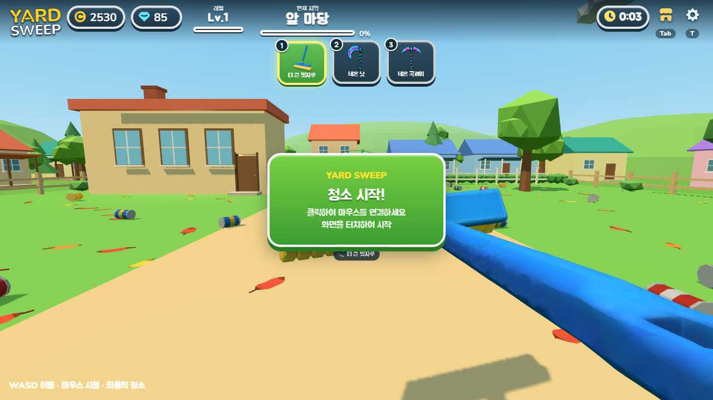
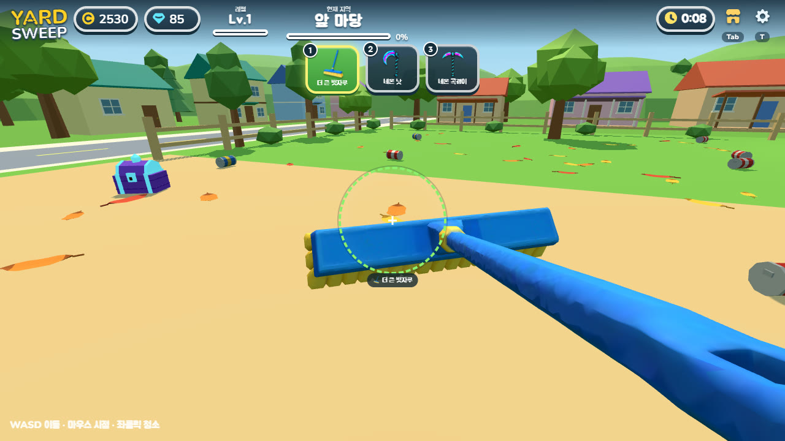
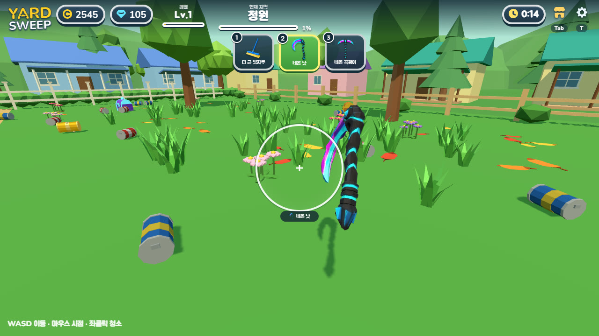
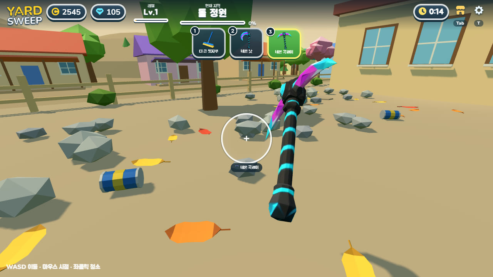
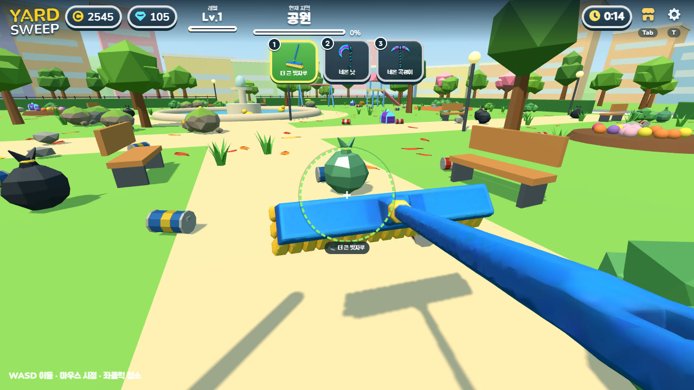
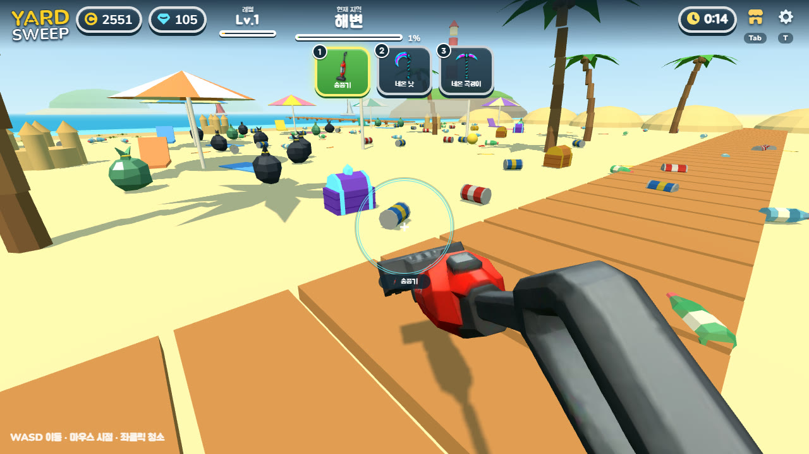
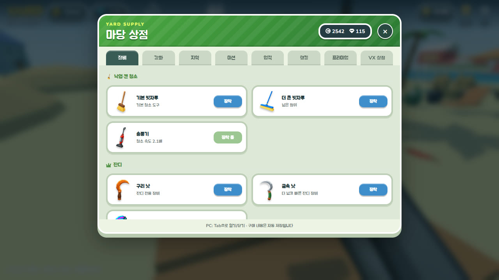
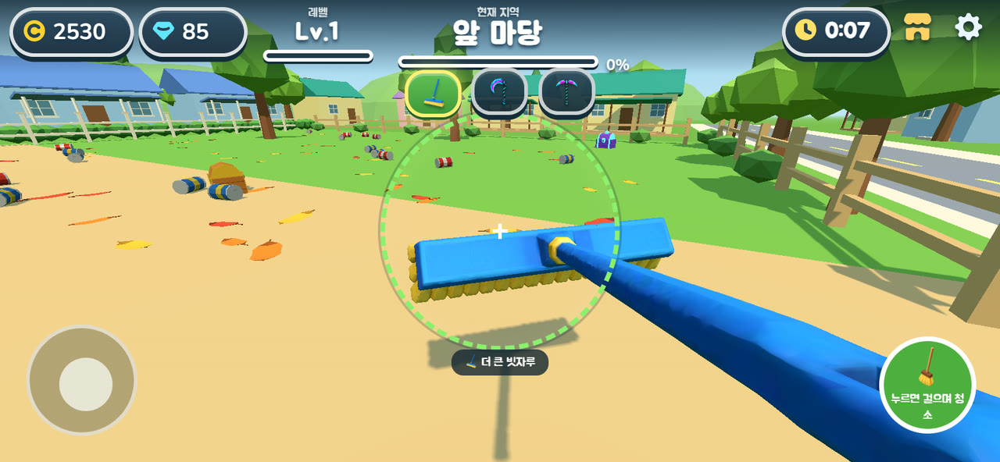

# Yard Sweep

> 빗자루 하나로 시작해 동네 마당을 전부 쓸어 버리자. 느긋한 1인칭 3D 청소 게임.

낙엽, 캔, 쓰레기봉투가 널린 마당을 돌아다니며 치우고, 모은 코인으로 더 좋은 도구와 능력을 사서
앞마당에서 해변까지 5개 지역을 차례로 여는 게임입니다. 빠르게 이어서 치우면 콤보가 쌓여 코인이 불어납니다.
Verse8(Agent8) 플랫폼에 배포했고, 설치 없이 PC·모바일 브라우저에서 바로 돌아갑니다.

**▶ 플레이: https://verse8.io/dl/games/j9M4G9t?referral=RCNU6B**

| 플랫폼 | 상태 |
|---|---|
| Verse8 | 서비스 중 |
| CrazyGames | 서비스 중 (https://www.crazygames.com/game/yard-sweep) |

<p>
  
</p>

<p>
  
  
</p>

## 어떤 게임인가

- **청소:** 화면 가운데 조준 원을 쓰레기에 맞추고 누르고 있으면 치워집니다. 치울 때마다 코인이 들어오고,
  끊기지 않게 이어 치우면 콤보 배율이 올라갑니다.
- **도구 8종, 3종류:** 낙엽·캔·쓰레기봉투는 빗자루와 송풍기, 풀과 덤불은 낫, 돌과 바위는 곡괭이로 치웁니다.
  종류마다 하나씩 장착해 두고 숫자키 1 / 2 / 3으로 바꿔 듭니다.
- **지역 5곳:** 앞마당 → 정원 → 돌 정원 → 공원 → 해변. 한 지역을 100% 치우면 완료 보상을 받고 다음 지역이 열립니다.
- **성장:** 청소 속도, 이동 속도, 청소 범위, 코인 보너스 네 가지 강화와, 혼자 돌아다니며 치우는 로봇청소기.
- **목표:** 미션, 업적, 앞마당의 일일 보물 상자, 황금 캔·보물 상자 같은 희귀 오브젝트.
- **랭킹:** 레벨 순위표와 닉네임. 진행 상황은 계정에 저장돼 다른 기기에서 이어서 합니다.

<p>
  
  
</p>
<p>
  
  
</p>

## 주요 기능

**모바일 조작**
- 가로 화면 전용. 조준 원에 쓰레기가 들어오면 버튼 없이 자동으로 치웁니다.
- 왼쪽 아래 조이스틱, 또는 화면 왼쪽 아무 곳이나 누르고 끌어서 이동. 오른쪽을 끌면 시점 회전.
- 오른쪽 아래 청소 버튼은 "걸으면서도 계속 치우기"용입니다.
- 세로로 들고 있으면 회전 안내만 띄우고, 가로로 돌린 뒤에 에셋을 받기 시작합니다.

<p>
  
</p>

**상점과 운영 요소**
- 마당 상점: 장비, 강화, 지역, 미션, 업적, 랭킹, 프리미엄, VX 상점 탭.
- 보석 묶음과 광고 제거는 VX 상점에서. 구매한 값은 서버 기록을 우선으로 맞춥니다.
- 리워드 광고: 지역 완료 보상 2배, 무료 보석(30분에 한 번).
- 4개 언어: 한국어, English, 日本語, 繁體中文.

## 조작

| | 키보드·마우스 | 터치 |
|---|---|---|
| 이동 | WASD | 조이스틱 / 화면 왼쪽 드래그 |
| 시점 | 마우스 | 화면 오른쪽 드래그 |
| 청소 | 좌클릭 누르고 있기 | 조준하면 자동 / 청소 버튼 |
| 도구 종류 전환 | 1 / 2 / 3 | 위쪽 도구 칸 탭 |
| 보물 상자 | F (상자 근처) | 상자 근처에서 뜨는 안내 탭 |
| 상점 / 설정 | Tab / T | 오른쪽 위 버튼 |

## 기술 스택

| 영역 | 사용 기술 |
|---|---|
| 클라이언트 | TypeScript, Vite 6, three.js 0.177, DOM UI(HUD·상점·설정) — 프레임워크 없이 바닐라 |
| 서버 | Verse8 Agent8 Game Server (`server/src/server.ts`: 랭킹, 닉네임, 클라우드 저장, VX 상태) |
| 플랫폼 | `@agent8/gameserver`, `@verse8/platform`(VX Shop), `@verse8/ads`(리워드 광고) |
| 아트 | 도구 8종: AI 3D 생성 로우폴리 카툰 모델(GLB), 청소 오브젝트·풍경: Blender Python 스크립트(`tools/blender/`) |

## 구조에서 신경 쓴 것

**저장은 최신 쪽을 쓴다**
진행 상황은 기기(localStorage)와 계정(서버) 양쪽에 저장합니다. 접속하면 두 저장의 시각을 비교해 더 최신인 쪽을 쓰고,
서버 저장은 5초 간격으로 모아 보내다가 탭을 벗어나면 바로 보냅니다.

**랭킹은 미리 받아 둔다**
접속하자마자 내 레벨을 서버에 올려 순위표에 내 줄을 만들고, 순위표를 미리 받아 캐시합니다.
상점의 랭킹 탭을 열면 기다림 없이 바로 뜨고 뒤에서 조용히 갱신됩니다.

**터치 자동 청소는 기존 규칙 위에 얹었다**
자동 청소는 "청소 버튼을 누르고 있는 상태"를 대신 켜고 끄는 것뿐이라, 판정·속도·보상은 PC와 같습니다.
이동 중에 쓸 수 없는 도구는 조이스틱을 놓았을 때만 자동으로 치워서, 걷다가 발이 묶이지 않습니다.

## 실행

```bash
npm install
npm run dev       # 개발 서버
npm run build     # 배포 빌드 (dist/)
```

서버 테스트:

```bash
npx -y @agent8/gameserver-node test
```

개발 서버에서는 콘솔의 `__ys`로 지역 이동(`__ys.enterRegion(3)`), 시점 이동, 렌더러 메모리 확인을 할 수 있습니다.

## 폴더

```
game/
  index.html        화면 구성(HUD, 상점, 설정, 모바일 조작)
  src/main.ts       게임 본체: 지역, 청소 판정, 도구, 상점, 저장, 입력
  src/gameData.ts   도구·카테고리 데이터
  src/scenery.ts    지역 바깥 풍경 (sceneryKit.ts: 풍경 모델 키트)
  src/ranking.ts    서버 연결: 랭킹, 닉네임, 클라우드 저장, VX 상점
  src/ads.ts        리워드 광고
  src/i18n.ts       4개 언어 문구
  public/assets/    모델(Yardsweep-*.glb), 이미지, 오디오
server/src/         게임 서버 (랭킹, 닉네임, 저장, VX 상태)
tools/blender/      청소 오브젝트·풍경 모델 생성 스크립트
tools/icons/        아이콘 시트 자르기
store-assets/       스토어 이미지, 플레이 영상
docs/screenshots/   이 문서의 스크린샷
GAME_DESIGN.md      기획서
```
